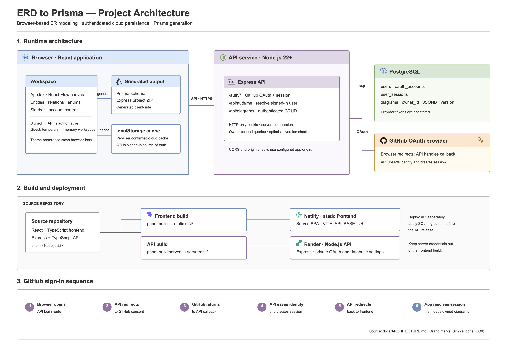

# ERD to Prisma


[](https://react.dev/)
[](https://www.typescriptlang.org/)
[](https://vite.dev/)
[](https://reactflow.dev/)
[](https://nodejs.org/)
[](https://www.postgresql.org/)
[](LICENSE)

Design a relational data model visually, then turn it into a Prisma schema or a
downloadable Express + Prisma starter project.


## Project overview

ERD to Prisma is a browser-based modeling tool for developers who want to move
from an entity relationship diagram to application-ready Prisma output. It
combines an interactive React Flow canvas with schema generation, optional
GitHub accounts, and PostgreSQL-backed diagram storage.

### What it can do

- **Model visually:** create entities, edit fields and enums, and connect
  entities with one-to-one, one-to-many, and many-to-many relationships.
- **Generate Prisma:** translate entities, field types, keys, constraints,
  enums, and relationships into a `schema.prisma` file.
- **Scaffold a project:** download a generated Express + Prisma starter in
  JavaScript or TypeScript, including the schema and project structure.
- **Save diagrams to an account:** sign in with GitHub to create, edit, rename,
  switch, and delete diagrams that persist in PostgreSQL.
- **Keep account data isolated:** the API scopes diagram operations to the
  authenticated user and uses version checks to reject stale updates.
- **Work as a guest:** signed-out diagrams are temporary. Browser storage is
  used as a per-user cache for confirmed cloud data, not as the source of truth.

## Architecture

The frontend is a static React application, deployed separately from the
Express API. The API handles GitHub OAuth, cookie-based sessions, and
owner-scoped diagram operations; PostgreSQL stores identities, sessions, and
diagrams.



See the [architecture guide](docs/ARCHITECTURE.md) for state ownership,
persistence behavior, and generation details.

## Technology

| Area | Technologies |
| --- | --- |
| Frontend | React 19, TypeScript 5.9, Vite 7 |
| Diagram editor | React Flow 12 |
| API | Node.js 22, Express 5, TypeScript |
| Authentication | GitHub OAuth, Passport, HTTP-only session cookies |
| Database | PostgreSQL, versioned SQL migrations |
| Validation and exports | Zod, JSZip |
| Deployment | Netlify static frontend, separate Node.js API, PostgreSQL |

## Run locally

### Start the frontend

Requirements: Node.js 22 or later and pnpm.

```bash
git clone https://github.com/FahadulShadhin/erd-to-prisma.git
cd erd-to-prisma
pnpm install
pnpm dev
```

Open the URL printed by Vite, usually
[http://localhost:5173](http://localhost:5173). The editor can be explored as a
guest; GitHub login and cloud saving require the API and PostgreSQL setup below.

### Run the API and enable GitHub login

The API is a separate process. Start PostgreSQL, then configure these
server-side values in `server/.env`:

- `DATABASE_URL`
- `SESSION_SECRET` (at least 32 characters)
- `GITHUB_CLIENT_ID`
- `GITHUB_CLIENT_SECRET`
- `APP_ORIGIN` (for example, `http://localhost:5173`)
- `API_ORIGIN` (for example, `http://localhost:3001`)
- Optional: `PORT` (defaults to `3001`) and `NODE_ENV`

Register a GitHub OAuth app with the local callback URL
`http://localhost:3001/auth/github/callback`. Then apply migrations and start
the API:

```bash
pnpm db:migrate
pnpm dev:server
```

In another terminal, run `pnpm dev`. Keep real credentials out of Git. The
development Vite server proxies `/api` and `/auth` to the local API.

## Deployment

- **Frontend:** build with `pnpm build` and deploy the static `dist/` output
  (the project is configured for Netlify). Set `VITE_API_BASE_URL` to the
  public API origin.
- **API:** deploy `server/` as a separate Node.js 22 service. Configure
  `DATABASE_URL`, `SESSION_SECRET`, GitHub OAuth credentials, `APP_ORIGIN`,
  `API_ORIGIN`, and `NODE_ENV` on the API host only.
- **Database:** run `pnpm db:migrate` against the production database before
  releasing API code that depends on a new migration.
- **OAuth:** set the GitHub callback URL to
  `<API_ORIGIN>/auth/github/callback`. Use same-site app/API domains where
  possible, or configure cross-site cookies and origins deliberately.

### Run the full stack with Docker Compose

Docker Compose starts PostgreSQL, applies database migrations, starts the API,
and serves the frontend through Nginx:

```bash
docker compose up --build
```

Open [http://localhost:8080](http://localhost:8080). The default local setup
supports guest use; GitHub login needs real `GITHUB_CLIENT_ID` and
`GITHUB_CLIENT_SECRET` values supplied in the shell or a root `.env` file.
Register the OAuth callback as
`http://localhost:8080/auth/github/callback`. Open the app at port `8080`;
Compose configures both OAuth origins to that address while Nginx proxies
requests to the API's internal port `3001`. Compose's placeholder OAuth
values and session secret are for local development only.

Stop the stack with `docker compose down`. The PostgreSQL volume is preserved;
use `docker compose down -v` only when you intend to delete local database
data.

## Useful commands

| Command | Purpose |
| --- | --- |
| `pnpm dev` | Start the Vite frontend |
| `pnpm dev:server` | Start the Express API in watch mode |
| `pnpm build` | Type-check and build the frontend |
| `pnpm build:server` | Build and type-check the API |
| `pnpm db:migrate` | Apply PostgreSQL migrations |
| `pnpm lint` | Run ESLint |
| `pnpm preview` | Preview the production frontend build |

## Project documentation

- [Architecture](docs/ARCHITECTURE.md)
- [Development and smoke tests](docs/DEVELOPMENT.md)
- [Agent workflow guide](AGENTS.md)

## Credits

Vectors and icons by [SVG Repo](https://www.svgrepo.com).
