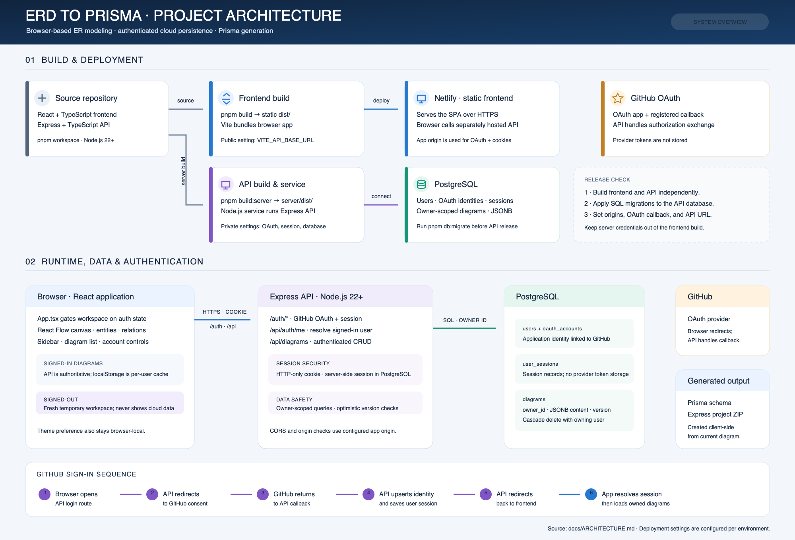

# Architecture



## Overview

ERD to Prisma is a Vite SPA with a separate Express API. React Flow provides the visual canvas; React state and `NodesContext` carry diagram mutations. The API handles GitHub authentication and stores user/provider identity, sessions, and user-owned diagrams in PostgreSQL.

## Main runtime flow

```text
App
  -> React Flow provider/canvas
  -> Sidebar
       -> AuthControl
            -> Express GitHub OAuth/session API
                 -> PostgreSQL users, OAuth identities, sessions, and diagrams
       -> typed diagram API
            -> owner-scoped PostgreSQL diagram queries
       -> generatePrismaSchema(nodes, edges, enums)
       -> PrismaModal
            -> copy/download schema.prisma
            -> generateExpressTemplates(schema)
                 -> JSZip download
```

The application is rendered from `src/main.tsx` and initialized in `src/App.tsx`.

## State ownership

`FlowCanvasWrapper` in `src/App.tsx` owns:

- The active diagram id and the authenticated user's diagram list.
- React Flow `nodes`, `edges`, and `onNodesChange`/`onEdgesChange`.
- Diagram-wide enum definitions.
- Field dropdown and enum editor UI state.
- Per-user diagram cache and browser-local theme preference.

It injects callback functions into node data and exposes shared data through `NodesContext`.

`NodesContext` is a bridge for components such as `TableNode` and `TypeDropdown`. It is not a replacement for React Flow or the application state in `App.tsx`.

`App` resolves the session before rendering a workspace. Signed-in startup loads
the user's diagrams from the API before mounting the canvas; signed-out users
start with a fresh in-memory diagram. `AuthControl` starts GitHub sign-in and
signs out. The API stores only the application user ID in its PostgreSQL-backed
session; provider tokens are not stored.

## Diagram data

Core types live in `src/types.ts`:

- `Field`: field name, Prisma type, primary/foreign key flags, nullable, and unique.
- `DiagramListItem`: lightweight id/name pair for sidebar display.

React Flow `Node` data contains `TableNodeData`, which is defined in `src/components/TableNode.tsx`. Its fields and callbacks describe a table and how it edits itself.

React Flow `Edge` data contains a `relationType` of `one-to-one`, `one-to-many`, or `many-to-many`. Relation UI is implemented in `src/components/RelationEdge.tsx`.

## Persistence

PostgreSQL is the source of truth for signed-in users. The authenticated diagram
API derives ownership from the session, and all create, update, and delete
queries are scoped by that owner. Updates and deletes use the diagram's separate
integer version to reject stale writes. The diagram entity remains exactly
`id`, `name`, `updatedAt`, `nodes`, `edges`, and `enums`.

`src/services/diagram-api.ts` owns the typed HTTP boundary and stores a cache
under `erd-to-prisma:diagrams:<user-id>`. A confirmed server load refreshes that
cache. It is not used to initialize a workspace while the API is available;
when the API is unavailable, the signed-in user's cache may be shown with an
offline indicator. Guest edits are in-memory only.

The former unscoped `erd-to-prisma:diagrams` format and legacy
`erd-to-prisma:flow` format are read only as explicit import candidates after
sign-in. They are never automatically uploaded or treated as the signed-in
workspace. The theme remains browser-local under `erd-to-prisma:theme`.

When changing persisted shapes:

1. Update the relevant runtime types.
2. Keep API validation compatible with React Flow properties, including
   optional `measured`, `selected`, and `dragging`.
3. Keep browser cache parsing user-scoped and preserve the explicit legacy
   import path.
4. Manually verify authenticated load, edit, switch, create, rename, delete,
   import, sign-out, and account-switch flows.

## Schema generation

`src/utils/generatePrisma.ts` is the conversion boundary from React Flow data to a complete Prisma schema.

Important invariants:

- Model names are capitalized from table names.
- Field names and relation fields are emitted directly except for documented timestamp normalization.
- Referenced enums only are included in the generated schema.
- Primary-key strategies map to `@id` plus `autoincrement()`, `cuid()`, or `uuid()` where applicable.
- One-to-one and one-to-many relations add foreign-key fields and relation fields.
- Many-to-many relations emit array relation fields on both models.

Changes to fields, edge data, enum data, or relation semantics must keep this generator and the corresponding UI in sync.

## Template generation

`src/components/TemplateModal.tsx` selects JavaScript or TypeScript output. `src/utils/generateTemplates.ts`:

- Extracts model names from `model Name {` declarations.
- Renders Express routes, controllers, services, middleware, package metadata, and README files.
- Copies the generated Prisma schema into `prisma/schema.prisma`.
- Creates a JSZip archive for browser download.
- Attempts npm registry lookups and retains template/fallback versions on failure.

Raw template sources are in `src/templates/express/`. Placeholder tokens use `{{name}}` syntax and are rendered by `render`.

## Styling

- `src/App.css`: application/canvas layout.
- `src/index.css`: global baseline and theme variables.
- `src/components/styles/main.css`: component styles for sidebar, nodes, modals, dropdowns, and relation edges.

Keep class names and theme variables consistent across components. Both light and dark modes are runtime states controlled by `data-theme` on `document.documentElement`.

## Build and deployment

- Vite builds static assets to `dist/`, deployed independently (currently on Netlify).
- `server/` is a Node.js 22+ TypeScript Express API deployed as a separate service.
- PostgreSQL stores application users, OAuth identities, and server sessions. Apply versioned SQL migrations with `pnpm db:migrate`.
- Configure `VITE_API_BASE_URL` on the frontend and server-only OAuth/database/session settings on the API. Do not expose server credentials in the Vite build.
- Use same-site app/API domains for cookie-based sessions, or configure the deployment proxy and cookies deliberately.
- `pnpm build` runs `tsc -b` and `vite build`.
- `pnpm build:server` type-checks and builds the API.
- `Dockerfile` uses Node 22 for build and Nginx for serving.
- `compose.yaml` publishes the app on host port 8080.
- `nginx.conf` serves the single-page application.

Generated output and dependencies should not be committed for routine source changes.
